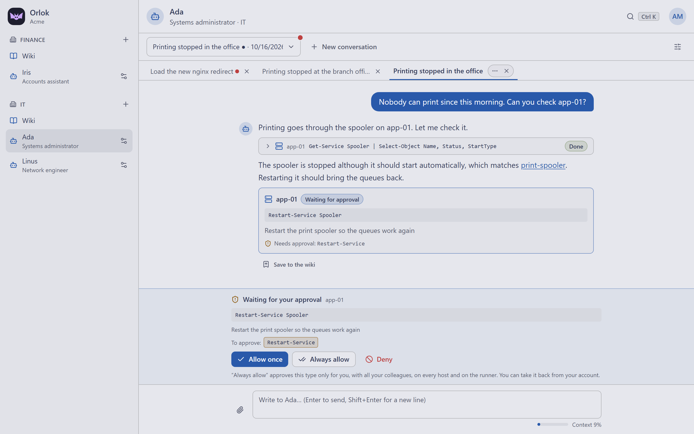
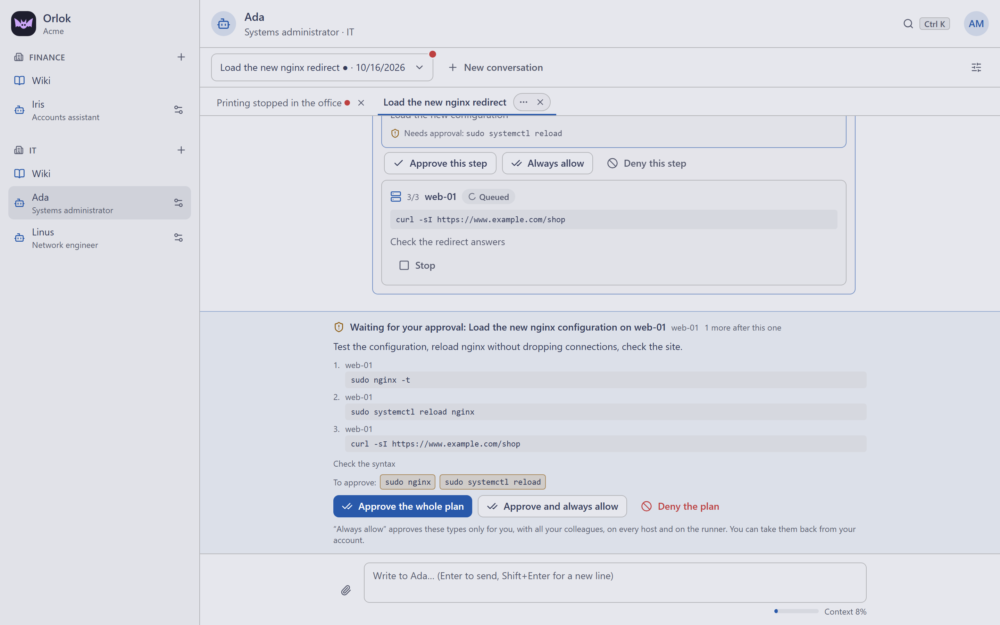
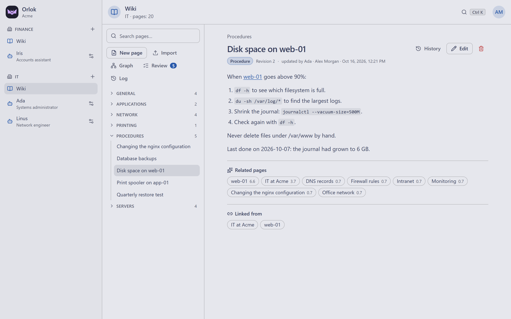
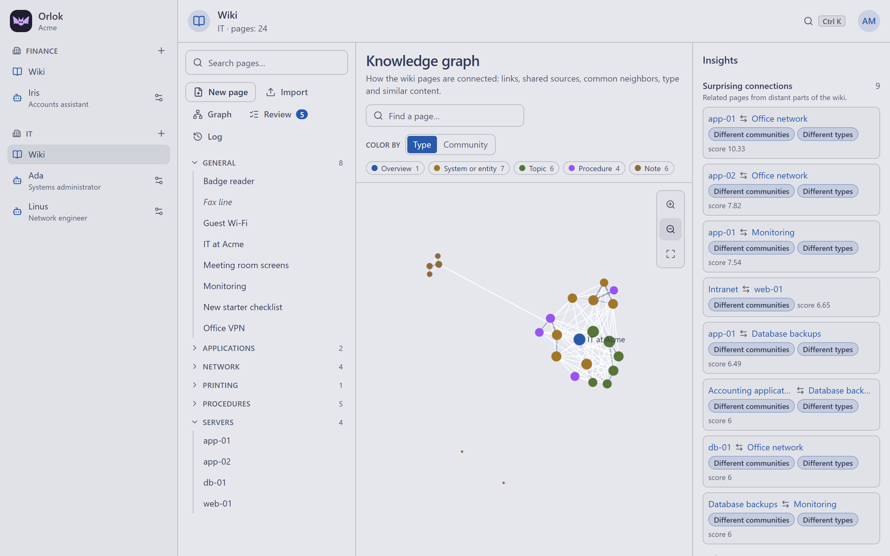
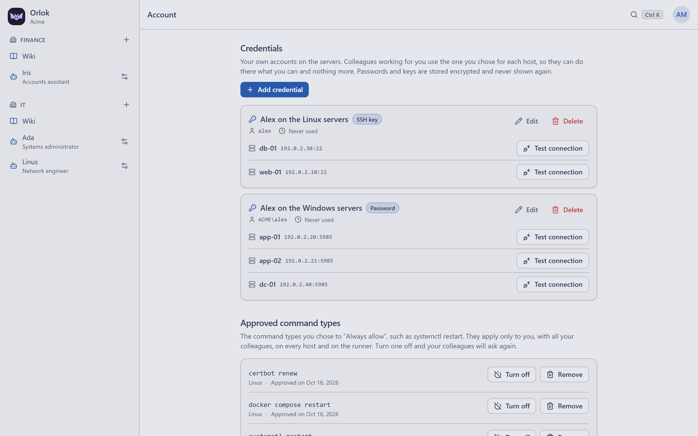
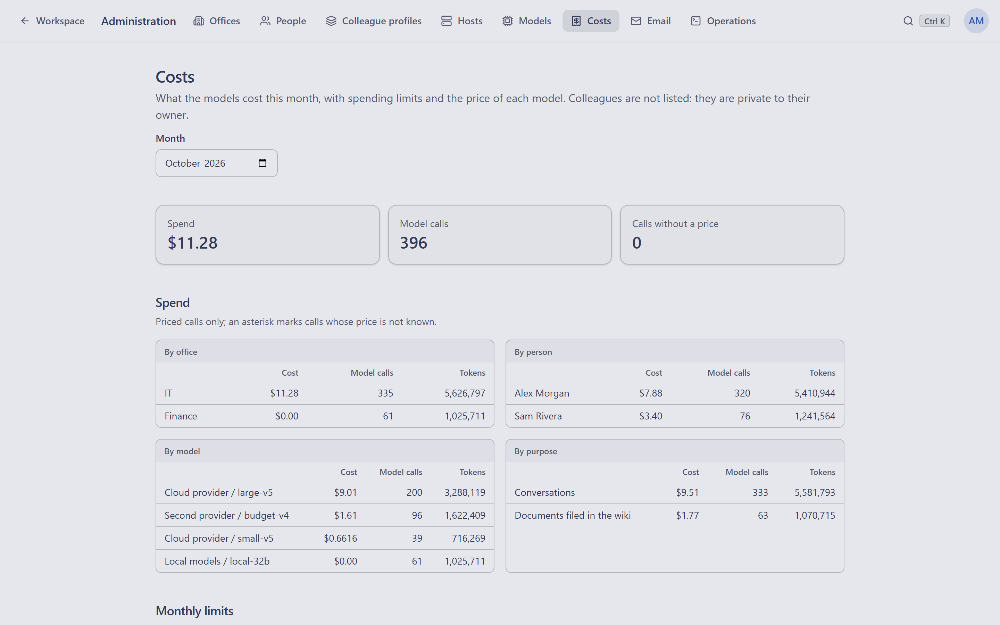

<p align="center">
  <a href="https://orlok.xyz"></a>
</p>

<h1 align="center">Orlok</h1>

<p align="center">
  <strong>Virtual colleagues for your offices</strong><br>
  A self-hosted platform of AI colleagues that know your infrastructure, act on your systems and follow your rules.
</p>

<p align="center">
  <a href="https://orlok.xyz"><strong>Website</strong></a> •
  <a href="https://orlok.xyz/docs">Documentation</a> •
  <a href="https://orlok.xyz/docs/installation">Installation</a> •
  <a href="https://orlok.xyz/#contact">Contact</a> •
  <a href="#license">License</a>
</p>

---

## About

Orlok gives every office of a company its own virtual colleagues. They answer in chat on the web, on phones and on Telegram, keep a shared wiki of what the office knows, and run commands on real servers with the access of the person who asked, only after approval. One installation per company, on your own servers, with the model of your choice.

**→ Learn more at [orlok.xyz](https://orlok.xyz)**

## Features

- **Virtual colleagues**: each person creates their own, with a model and mode granted by administrators. [Colleagues](https://orlok.xyz/docs/colleagues) · [Conversations](https://orlok.xyz/docs/conversations)
- **Office wiki**: a shared knowledge base that colleagues read before answering and keep up to date, with revisions, search, a knowledge graph and a review queue. [Wiki](https://orlok.xyz/docs/wiki)
- **Document and notes import**: PDF, Office files and scans (local OCR), and Markdown from Obsidian, Notion or Joplin. [Documents](https://orlok.xyz/docs/wiki-import-documents) · [Notes](https://orlok.xyz/docs/wiki-import-notes)
- **Real operations**: SSH and PowerShell on Linux and Windows hosts, run from an isolated container with each person's own credentials. [Operations](https://orlok.xyz/docs/operations) · [Hosts](https://orlok.xyz/docs/hosts)
- **Approvals**: commands are parsed, not matched as text; approve once, always or as a plan, from desktop, phone or Telegram. [Approvals](https://orlok.xyz/docs/approvals) · [Profile modes](https://orlok.xyz/docs/profile-modes)
- **MCP servers**: tools shared by every colleague of an office, from a ready-made catalog. [MCP servers](https://orlok.xyz/docs/mcp-servers)
- **Any model**: Anthropic, OpenAI, compatible providers or local models through Ollama, with costs and monthly limits. [Models](https://orlok.xyz/docs/models) · [Costs](https://orlok.xyz/docs/costs)
- **Audit**: every change and command in an append-only log, exportable as CSV or JSON Lines. [Audit](https://orlok.xyz/docs/audit)
- **For everyone**: English and Italian, ten colour themes, keyboard command palette, installable phone app. [Languages and themes](https://orlok.xyz/docs/language-and-themes)

## Screenshots

<table>
  <tr>
    <td width="50%">
      <picture><source media="(prefers-color-scheme: dark)" srcset="demo/output/site/chat-dark.png"></picture>
      <p align="center"><sub><b>Conversations</b>: a colleague checks a server and reports back</sub></p>
    </td>
    <td width="50%">
      <picture><source media="(prefers-color-scheme: dark)" srcset="demo/output/site/plan-dark.png"></picture>
      <p align="center"><sub><b>Plans</b>: approve a change as a whole or step by step</sub></p>
    </td>
  </tr>
  <tr>
    <td width="50%">
      <picture><source media="(prefers-color-scheme: dark)" srcset="demo/output/site/wiki-page-dark.png"></picture>
      <p align="center"><sub><b>Office wiki</b>: pages written and kept current by colleagues</sub></p>
    </td>
    <td width="50%">
      <picture><source media="(prefers-color-scheme: dark)" srcset="demo/output/site/wiki-graph-dark.png"></picture>
      <p align="center"><sub><b>Knowledge graph</b>: how the office's topics connect</sub></p>
    </td>
  </tr>
  <tr>
    <td width="50%">
      <picture><source media="(prefers-color-scheme: dark)" srcset="demo/output/site/credentials-dark.png"></picture>
      <p align="center"><sub><b>Credentials</b>: each person's own accounts, per host</sub></p>
    </td>
    <td width="50%">
      <picture><source media="(prefers-color-scheme: dark)" srcset="demo/output/site/costs-dark.png"></picture>
      <p align="center"><sub><b>Costs</b>: spending by office, person and model, with limits</sub></p>
    </td>
  </tr>
</table>

More on [orlok.xyz](https://orlok.xyz/#screenshots).

## Quick start

Orlok runs with Docker Compose: the app, PostgreSQL with pgvector, and an isolated runner for commands.

```bash
cp .env.production.example .env.production   # set the secrets and ORLOK_PUBLIC_URL
docker compose --env-file .env.production up -d --build
```

Open the configured address (port 8080 by default) to create the company and the first administrator. The full guide covers [requirements](https://orlok.xyz/docs/requirements), [installation](https://orlok.xyz/docs/installation), [HTTPS](https://orlok.xyz/docs/https), [backup](https://orlok.xyz/docs/backup) and [upgrades](https://orlok.xyz/docs/upgrade).

## Security

Orlok runs on your infrastructure and can run fully offline with local models. Credentials are encrypted with a key kept outside the database; colleagues act with the requesting person's access and never see the credentials. Commands run in a separate container without database access, on a read-only filesystem with minimal privileges. See the [security model](https://orlok.xyz/docs/security-model) and [hardening](https://orlok.xyz/docs/security-hardening).

## Tech stack

- **Backend**: Node.js, TypeScript, Hono, Drizzle ORM
- **Frontend**: React, Vite, Tailwind CSS, shadcn/ui
- **Database**: PostgreSQL with pgvector
- **Runner**: isolated container for SSH, PowerShell and local MCP servers
- **Models**: Anthropic, OpenAI and OpenAI-compatible APIs, Ollama; built-in multilingual embeddings

Building from source and contributing: see [CONTRIBUTING.md](CONTRIBUTING.md).

## License

Orlok is **source-available** under the [Business Source License 1.1](LICENSE).

**Free, no license needed:**

- Personal use: yourself, at home, on your own devices, or to learn
- Non-profit organizations, for their own purposes
- Schools and universities, for teaching and research
- Development, testing and evaluation, for everyone

**Needs a commercial license:**

- Production use for a company, an employer or clients, freelancers and managed service providers included. [Contact us](https://orlok.xyz/#contact).

Each version becomes available under the Apache License 2.0 four years after its release. This summary is not the license: see [LICENSE](LICENSE) for the exact terms. The Orlok name and logo are not covered by the license.

## Links

- **Website**: [orlok.xyz](https://orlok.xyz)
- **Documentation**: [orlok.xyz/docs](https://orlok.xyz/docs)
- **Commercial licensing**: [orlok.xyz/#contact](https://orlok.xyz/#contact)

---

© 2026 Marco Ziliani and Monica Marchiani
